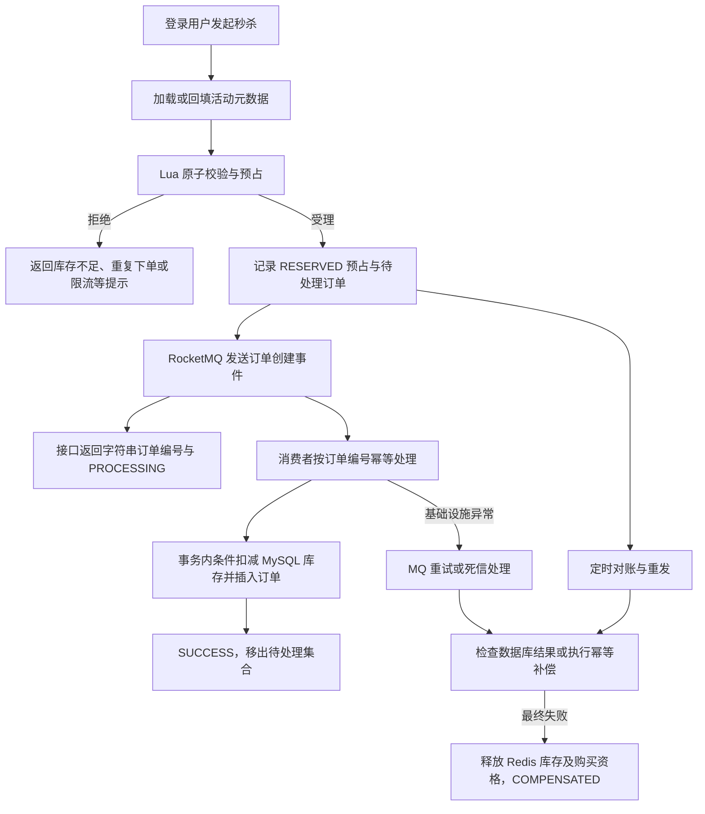

# CityLife · 城市生活点评平台

CityLife 是一个前后端分离的本地生活演示项目，覆盖商铺浏览、探店笔记、关注与动态流、优惠券以及秒杀下单。后端使用 Spring Boot、MyBatis-Plus、MySQL 和 Redis，秒杀订单通过 RocketMQ 异步创建；前端采用 Vue 2、Element UI 和 Axios，可由 Nginx 直接托管。

项目以黑马点评学习项目为基础，保留原有 `com.hmdp` 包名、应用入口及 Maven 制品名，重点展示 Redis 数据结构、缓存策略、并发控制与异步订单的一致性处理。仓库名称为 **CityLife**。

## 目录导航

- [功能与实现](#功能与实现)
- [技术栈](#技术栈)
- [项目结构](#项目结构)
- [秒杀订单链路](#秒杀订单链路)
- [本地启动](#本地启动)
- [配置说明](#配置说明)
- [主要接口](#主要接口)
- [测试与构建](#测试与构建)
- [常见问题](#常见问题)
- [仓库内容与凭据管理](#仓库内容与凭据管理)

## 功能与实现

| 模块 | 当前实现 |
| --- | --- |
| 登录与会话 | 手机验证码登录、首次登录自动创建用户、Redis 保存验证码和 Token、拦截器刷新会话、ThreadLocal 传递用户上下文 |
| 商铺 | 分类与分页查询、名称搜索、详情查询、缓存空值防穿透、更新数据库后删除缓存、Redis GEO 附近商铺查询 |
| 探店笔记 | 发布图文笔记、热门笔记、点赞与点赞用户查询、本人及其他用户笔记列表 |
| 关注与动态 | 关注/取消关注、共同关注、基于 Redis Sorted Set 的关注动态和滚动分页 |
| 签到 | Redis Bitmap 记录每日签到，统计本月截至当日的连续签到天数 |
| 优惠券 | 普通优惠券和秒杀优惠券、商铺优惠券列表、秒杀活动元数据与库存初始化 |
| 秒杀订单 | Lua 原子校验及库存预占、用户维度限流、一人一单、RocketMQ 异步落库、幂等消费、状态查询、重试与补偿 |
| 图片 | 本地图片上传与删除，静态图片由 Nginx 提供 |

`CacheClient` 中保留了互斥锁及逻辑过期等缓存策略供学习；当前商铺详情使用缓存空值方案。部分实体、控制器和旧秒杀实现作为演进记录保留，不能据此认为评论、支付、退款或后台管理流程已经完整实现。

## 技术栈

| 组件 | 版本 / 用途 |
| --- | --- |
| Java | Maven 编译目标 Java 8；推荐使用 JDK 17 构建和运行 |
| Maven | 3.6+ |
| Spring Boot | 2.3.12.RELEASE |
| MyBatis-Plus | 3.4.3 |
| MySQL | 推荐 5.7 / 8.0；连接驱动为 5.1.47 |
| Spring Data Redis / Lettuce | 2.6.2 / 6.1.6.RELEASE |
| Redis | 推荐 6.2+；当前配置为单节点模式 |
| Redisson | 3.13.6，用于分布式锁示例 |
| RocketMQ Spring Boot Starter | 2.3.0；现有链路使用 RocketMQ 5.3.4 Broker 环境 |
| Hutool | 5.7.17 |
| Vue / Element UI / Axios | 仓库内置静态脚本，无需 npm 构建 |
| Nginx | 静态资源托管、`/api/` 反向代理 |

这些版本主要服务于学习和功能演示；对外部署前应完成依赖升级评估、鉴权与资源访问控制等工程化工作。仓库不提供吞吐量或生产容量保证。

## 项目结构

```text
CityLife/
├── README.md
├── .gitignore
├── deploy/
│   └── nginx.conf.example           # 前端托管与 API 代理示例
├── backend/
│   ├── pom.xml
│   └── src/
│       ├── main/
│       │   ├── java/com/hmdp/
│       │   │   ├── HmDianPingApplication.java
│       │   │   ├── config/          # MVC、MyBatis、Redisson、定时任务配置
│       │   │   ├── controller/      # HTTP 接口
│       │   │   ├── dto/             # 统一响应、秒杀事件和订单状态
│       │   │   ├── entity/          # 数据实体
│       │   │   ├── mapper/          # 数据访问
│       │   │   ├── service/         # 业务逻辑
│       │   │   ├── mq/              # 生产者、普通消费者、死信消费者
│       │   │   ├── task/            # 订单预占对账任务
│       │   │   └── utils/           # 缓存、会话、ID、状态与预占工具
│       │   └── resources/
│       │       ├── application-example.yaml
│       │       ├── db/
│       │       │   ├── schema.sql   # 纯结构，含一人一单唯一索引
│       │       │   ├── data-demo.sql # 虚构商铺与分类数据
│       │       │   └── migration/   # 旧库唯一索引升级脚本
│       │       ├── mapper/
│       │       └── *.lua            # 受理、补偿及锁脚本
│       └── test/                   # 单元测试、集成测试和 test profile
└── front/                          # HTML、CSS、JS、字体和演示图片
```

## 秒杀订单链路



1. 服务端生成订单编号，Lua 同时完成活动状态、开始/结束时间、固定窗口限流、剩余库存和一人一单检查。
2. 受理成功后，Lua 扣减 Redis 库存、登记购买资格、保存预占记录，并把订单加入待处理 ZSet。
3. 生产者等待 Broker 发送确认；接口不等待数据库建单，返回 `PROCESSING`。发送失败时保留预占，交由定时任务重发。生产者发送本身是同步调用，因此受理耗时仍受 MQ 发送超时影响。
4. 消费者按 `orderId` 幂等处理，在同一个数据库事务中执行 `stock > 0` 的条件扣减和订单插入。`(user_id, voucher_id)` 唯一索引是数据库的一人一单约束。
5. 消费、对账和补偿共用单订单锁，减少“落库”与“释放预占”交错。可重试的基础设施异常交给 MQ；业务冲突执行补偿。
6. 对账默认每 10 秒扫描，`RESERVED` 超过 5 秒可重发，`SENT` 超过 60 秒检查数据库结果；重发次数上限默认 5。死信消费者也可触发补偿。

| 内部预占状态 | 含义 | 前端可见状态 |
| --- | --- | --- |
| `RESERVED` | Redis 已预占，发送尚未确认 | `PROCESSING` |
| `SENT` | 已确认发送事件 | `PROCESSING` |
| `SUCCESS` | 数据库已创建订单 | `SUCCESS` |
| `COMPENSATED` | 最终失败并释放预占 | `FAILED` |

订单编号在请求/响应和前端轮询中使用字符串，避免超过 JavaScript 安全整数范围。状态查询校验当前用户身份，只允许查询自己的订单。

该链路采用最终一致性设计，依赖 Redis 预占数据和 MQ 持久化；严重的数据丢失仍需要恢复与人工核对。Lua 脚本动态拼接多个 key，当前方案按单 Redis 节点部署，不能直接视为 Redis Cluster 方案。

### Redis 数据组织

| Key 前缀 | 数据结构 / 用途 |
| --- | --- |
| `login:code:` / `login:token:` | 验证码 String / 登录用户 Hash |
| `cache:shop:` | 商铺 JSON 缓存或空值 |
| `shop:geo:` | 按商铺分类维护 GEO 坐标 |
| `blog:liked:` / `feed:` | 点赞用户、关注动态 Sorted Set |
| `sign:` | 月度签到 Bitmap |
| `seckill:stock:` | 活动剩余预占库存 String |
| `seckill:activity:` | 活动时间、状态及初始库存 Hash |
| `seckill:order:` | 活动已预占用户 Set |
| `seckill:order:reservation:` | 单订单预占 Hash；`:pending` 为待处理 ZSet |
| `seckill:metrics:` | 按天统计的受理、成功、补偿等 Hash 指标 |

## 本地启动

### 1. 准备环境与克隆

安装 JDK 17、Maven 3.6+、MySQL、Redis、RocketMQ 和 Nginx。确认 `mvn -version` 显示的 Java 版本符合预期。

```bash
git clone https://github.com/chenheping975-lab/CityLife.git
cd CityLife
```

默认示例端口：前端 `8080`、后端 `8081`、MySQL `3306`、Redis `6379`、RocketMQ NameServer `9876`。Broker 广播地址和端口必须能被后端直接访问，仅 NameServer 可达不足以完成消息发送。

### 2. 创建数据库

使用 MySQL 客户端登录，在**新建的空库**中执行：

```sql
CREATE DATABASE citylife CHARACTER SET utf8mb4 COLLATE utf8mb4_general_ci;
USE citylife;
SOURCE /absolute/path/to/CityLife/backend/src/main/resources/db/schema.sql;
SOURCE /absolute/path/to/CityLife/backend/src/main/resources/db/data-demo.sql;
```

`SOURCE` 是 MySQL 客户端命令；Windows 路径建议使用正斜杠。`data-demo.sql` 是可选的虚构演示数据，不含账号、手机号、订单或真实业务数据。请自行创建具有该库必要权限的应用数据库用户，并把凭据保存在本机。

`schema.sql` 已包含 `uk_user_voucher` 唯一索引，初始化新库后不要再运行同名索引迁移。已有旧库可参考 `db/migration/20261106_add_unique_user_voucher.sql`：先单独执行重复数据和索引预检，再决定是否执行 `ALTER TABLE`；脚本不会自动消除重复订单。

### 3. 配置后端

在项目根目录复制示例：

```powershell
Copy-Item backend/src/main/resources/application-example.yaml backend/src/main/resources/application.yaml
```

Linux / macOS 可使用：

```bash
cp backend/src/main/resources/application-example.yaml backend/src/main/resources/application.yaml
```

在**启动后端的同一个终端**中设置 `DB_PASSWORD`。可在 IDE 的运行配置中注入环境变量，或在本机 `application.yaml` 中填写连接信息。以下 PowerShell 交互输入示例不会把密码字面量写入命令历史：

```powershell
$databaseCredential = Get-Credential -UserName citylife -Message '输入本机 CityLife 数据库账号'
$env:DB_USERNAME = $databaseCredential.UserName
$env:DB_PASSWORD = $databaseCredential.GetNetworkCredential().Password
# 按实际环境设置，示例默认 Redis 无密码；有认证时请设置 REDIS_PASSWORD。
$env:REDIS_HOST = '127.0.0.1'
$env:REDIS_PORT = '6379'
$env:ROCKETMQ_NAME_SERVER = '127.0.0.1:9876'
```

`.env` 文件不会由当前 Spring Boot 项目自动加载；使用环境变量时需由终端、IDE 或部署工具注入。真实 `application.yaml` 和 `.env` 已在忽略规则中。

### 4. 准备 RocketMQ Topic

先启动 NameServer 和 Broker。在 RocketMQ 安装目录的 `bin/` 下使用管理工具创建业务和死信 Topic。以下为 Bash 示例；`DefaultCluster` 应替换为实际集群名称：

```bash
sh mqadmin updateTopic -n 127.0.0.1:9876 -c DefaultCluster -t seckill-order-topic -r 8 -w 8
sh mqadmin updateTopic -n 127.0.0.1:9876 -c DefaultCluster -t '%DLQ%seckill-order-consumer-group' -r 4 -w 4
```

若修改消费组，需同时调整对应的 `%DLQ%消费组名` 配置与 Topic。消费者默认开启；关闭消费者只适用于诊断，并不能取代 MQ 配置或提供完整下单功能。

### 5. 启动后端

```bash
cd backend
mvn spring-boot:run
```

默认后端入口是 `http://localhost:8081`，例如 `GET /shop-type/list`。Spring Boot 不托管 `front/` 目录，也没有配置 `/api` 上下文路径。

图片上传目录由 `CITYLIFE_UPLOAD_DIR` 控制。从 `backend/` 工作目录启动时，默认目录为 `../front/imgs/`。若从其他目录或部署 JAR 启动，设置它为前端图片目录的绝对路径，并保证进程有写权限。

### 6. 启动前端

参考 `deploy/nginx.conf.example`，把 `server` 配置加入 Nginx 的 `http` 配置块，并将 `root` 改成 `front/` 的绝对路径。Windows 下也使用正斜杠，例如 `D:/projects/CityLife/front`。

```bash
nginx -t
nginx -s reload
```

若 Nginx 尚未运行，检查配置后启动 Nginx。访问 [http://localhost:8080](http://localhost:8080)。前端请求 `/api/...`，Nginx 的 `proxy_pass http://127.0.0.1:8081/` 会去掉 `/api/` 前缀；末尾斜杠需要保留。

### 7. 登录和初始化演示功能

- 打开登录页，使用本地测试手机号请求验证码。当前实现没有接入短信服务，验证码写入 Redis 并输出到后端 DEBUG 日志；输入该验证码即可自动注册/登录。
- 导入演示数据后可浏览分类和演示商铺。仓库没有预置真实用户或登录 Token。
- 附近商铺按坐标查询前，需要将商铺经纬度写入 Redis GEO，可执行下面的初始化测试方法（仅对本地演示库使用）：

  ```bash
  mvn "-Dtest=HmDianPingApplicationTests#loadShopData" test
  ```

- 秒杀活动需要通过 `POST /voucher/seckill` 新建，提交 `shopId`、`title`、`payValue`、`actualValue`、`type=1`、`status=1`、`stock`、`beginTime` 和 `endTime` 等信息。金额单位为分，时间使用 `yyyy-MM-dd'T'HH:mm:ss`，并与后端时区保持一致。新建后会在数据库事务提交后初始化 Redis 活动。
- 示例活动时间不会被预置，避免克隆项目时活动已经过期。正常登录后，在商铺详情页发起抢购，前端会轮询最终订单状态。

## 配置说明

配置模板：[`backend/src/main/resources/application-example.yaml`](backend/src/main/resources/application-example.yaml)。Redisson 与 Spring Redis 共用地址、密码及数据库配置，不再需要分别修改 Java 代码。

| 环境变量 | 示例默认值 | 说明 |
| --- | --- | --- |
| `SERVER_PORT` | `8081` | 后端端口 |
| `DB_URL` | `jdbc:mysql://127.0.0.1:3306/citylife?...` | 数据库连接串 |
| `DB_USERNAME` | `citylife` | 数据库用户 |
| `DB_PASSWORD` | 无，必须提供 | 数据库密码 |
| `REDIS_HOST` / `REDIS_PORT` | `127.0.0.1` / `6379` | Redis 地址 |
| `REDIS_PASSWORD` | 空 | Redis 密码，无认证时留空 |
| `REDIS_DATABASE` | `0` | Redis 逻辑数据库 |
| `ROCKETMQ_NAME_SERVER` | `127.0.0.1:9876` | NameServer 地址 |
| `ROCKETMQ_PRODUCER_GROUP` | `seckill-order-producer-group` | 生产者组 |
| `SECKILL_TOPIC` | `seckill-order-topic` | 订单事件 Topic |
| `SECKILL_CONSUMER_GROUP` | `seckill-order-consumer-group` | 普通消费者组 |
| `SECKILL_DLQ_TOPIC` | `%DLQ%seckill-order-consumer-group` | 与普通消费组对应的死信 Topic |
| `SECKILL_DLQ_CONSUMER_GROUP` | `seckill-order-dlq-consumer-group` | 死信消费者组 |
| `CITYLIFE_UPLOAD_DIR` | `../front/imgs/` | 本地图片保存目录，由 Java 读取 |
| `APP_LOG_LEVEL` | `debug` | 业务日志级别；本地演示用于查看验证码 |

限流和对账阈值位于模板中的 `seckill.rate-limit` 与 `seckill.reconcile`。修改前请结合 MQ 超时、重试与库存一致性一起评估。

## 主要接口

以下均为后端路径。通过 Nginx 访问时在前面添加 `/api`。登录后使用请求头 `authorization: <登录接口返回的 Token>`，当前实现不使用 `Bearer` 前缀。

| 方法 | 路径 | 用途 |
| --- | --- | --- |
| POST | `/user/code?phone=...` | 请求验证码 |
| POST | `/user/login` | JSON 提交 `phone`、`code`，返回 Token |
| GET | `/user/me` | 当前登录用户 |
| POST / GET | `/user/sign` / `/user/sign/count` | 签到 / 连续签到天数 |
| GET | `/shop-type/list` | 商铺分类 |
| GET | `/shop/{id}` | 商铺详情 |
| GET | `/shop/of/type?typeId=1&current=1` | 按类型分页；可追加 `x`、`y` 查询附近商铺 |
| GET | `/shop/of/name?name=...&current=1` | 商铺名称搜索 |
| GET | `/blog/hot?current=1` | 热门笔记 |
| POST | `/blog` | 发布笔记 |
| PUT | `/blog/like/{id}` | 点赞 / 取消点赞 |
| GET | `/blog/of/follow` | 关注动态滚动查询 |
| PUT | `/follow/{id}/{isFollow}` | 关注 / 取消关注 |
| GET | `/follow/common/{id}` | 共同关注 |
| GET | `/voucher/list/{shopId}` | 商铺优惠券 |
| POST | `/voucher/seckill` | 创建秒杀券与活动 |
| POST | `/voucher-order/seckill/{id}` | 抢购指定秒杀券，需登录 |
| GET | `/voucher-order/{orderId}` | 查询本人订单最终状态，需登录 |
| POST | `/upload/blog` | Multipart 上传图片，字段名 `file` |

统一响应使用 `success`、`errorMsg`、`data` 和可选 `total` 字段。秒杀受理示例：

```json
{
  "success": true,
  "data": {
    "orderId": "123456789012345678",
    "status": "PROCESSING"
  }
}
```

随后查询订单，可得到 `PROCESSING`、`SUCCESS` 或 `FAILED`，失败时带有 `reason`。`PROCESSING` 表示请求已受理，不能在此时显示为已完成购买。

## 测试与构建

### 无需中间件的单元测试

在 `backend/` 执行：

```bash
mvn "-Dtest=SeckillOrderUnitTest,NormalTest" test
```

现有测试覆盖订单编号字符串精度、状态及 Lua 返回码映射、DTO 序列化等。其中 `NormalTest` 是基础位运算演示。

### 集成测试

`SeckillOrderIntegrationTest` 需要真实 MySQL、Redis 和 RocketMQ，会创建并清理测试数据，覆盖异步落库、并发库存、一人一单、时间窗口、限流、幂等消费、补偿、跨用户查询及事务回滚等场景。

1. 将 `DB_URL` 指向**专用测试数据库**，先导入 `schema.sql`。
2. test profile 使用 Redis DB `1` 和独立的 MQ Topic / 消费组。Redis DB `1` 也应为测试专用。
3. 使用 `mqadmin` 创建 `seckill-order-topic-test` 和 `%DLQ%seckill-order-consumer-group-test`，方式与业务 Topic 相同。
4. 执行：

   ```bash
   mvn "-Dtest=SeckillOrderIntegrationTest" test
   ```

直接执行 `mvn test` 还会运行依赖中间件的旧 Spring Boot 测试，其中包含缓存、GEO 和 HyperLogLog 数据写入。需要可用的隔离环境，不应对现有业务库直接运行全部测试。POM 已为 JDK 9+ 的测试 JVM 配置必要的 `--add-opens`；直接 `java -jar` 运行时若遇到相关反射限制，可显式传入相同选项。

### 打包与运行 JAR

```bash
mvn -DskipTests package
java --add-opens java.base/java.lang=ALL-UNNAMED --add-opens java.base/java.lang.invoke=ALL-UNNAMED --add-opens java.base/java.nio=ALL-UNNAMED --add-opens java.base/java.util=ALL-UNNAMED -jar target/hm-dianping-0.0.1-SNAPSHOT.jar
```

`-DskipTests` 跳过测试执行，不代表已通过集成验证。若构建时把本地真实配置放在 `src/main/resources/application.yaml`，Maven 会将其打包进 JAR；对外分发制品前请改为通过外部配置和环境变量注入，勿分享含凭据的本地制品。

## 常见问题

| 现象 | 检查方式 |
| --- | --- |
| 启动提示无法解析 `DB_PASSWORD` | 确认已复制配置示例，并在当前终端或 IDE 中设置数据库密码 |
| 数据库连接失败 | 检查库名、账号授权、端口、驱动及 MySQL 认证插件兼容性；MySQL 8 默认认证若与旧驱动不兼容，需评估升级驱动或配置兼容账号 |
| Redis 连接或认证失败 | 检查 `spring.redis`；Redisson 使用同一份配置，认证为空时不会发送密码 |
| RocketMQ 无路由或消费者启动失败 | 检查 NameServer、Broker 广播地址、Topic、普通和死信消费组以及防火墙 |
| 前端 API 返回 404 或跨域错误 | 使用 Nginx 同源代理，确认 `/api/` 转发时移除了前缀，后端端口与代理一致 |
| 附近商铺列表为空 | 确认数据库有坐标，并执行 `loadShopData` 将 GEO 数据写入当前 Redis DB |
| 秒杀显示未开始或已结束 | 创建当前有效的活动；检查服务端时区和活动起止时间 |
| 订单持续处理中 | 检查普通消费者、MQ 路由、数据库、待处理预占及对账日志，查询对应 `orderId` 的完整处理过程 |
| 上传图片后无法显示 | 检查 `CITYLIFE_UPLOAD_DIR` 与 Nginx 静态图片目录是否指向同一位置及进程权限 |

当前验证码以日志方式模拟短信，上传和部分管理接口也未具备完整权限模型，适合本地学习。需要公开提供服务时，应先完善访问控制、验证码发送、上传验证、限流和依赖维护；公开源码并不意味着可直接公开部署。

## 仓库内容与凭据管理

- 仅提交配置示例；真实数据库 / Redis 密码、API 密钥、证书、`.env` 和本机运行配置保存在本地。
- 数据库提供纯结构与虚构演示种子；原始数据库导出文件 `hmdp.sql` 不进入仓库。
- JMeter 目录、`.jmx` 测试计划、`.jtl` 报告及其中可能存在的 Token 数据不提交。
- `.claude`、`.agents`、`.codex`、`.specify`、`.playwright-mcp`、AI 指令、技能锁文件及开发过程 `specs/` 不提交。
- IDE 配置、日志、`target/`、JAR 包等本地生成内容由 `.gitignore` 排除。

项目包含学习项目来源的代码、前端库及演示资源，并保留已有作者注释。使用或再分发这些内容时，请核对各自来源和使用条件；本仓库未为第三方内容追加统一授权。
